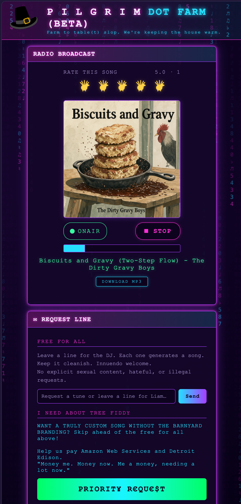

# Pilgrim Dot Farm Radio

A fictional small-town station that makes its own music and keeps playing. MiniMax
Music 3 generates songs; LLMs write the news, ads, and DJ copy; Kokoro gives the
station its voices. The browser plays finished, checked audio from the library,
so listeners never wait for a song to render.



## Get started

The Makefile uses Python 3.14. Install `ffmpeg` and `ffprobe`, then set the
backend addresses and models in [pilgrim/config.yaml](pilgrim/config.yaml).
Their observed request formats are recorded in [docs/backends.md](docs/backends.md).
Put `LITELLM_TOKEN=...` in a git-ignored `.env` file at the repo root.
The Docker gateway variant's Tailscale sidecar reads `TS_AUTHKEY` from an env
file outside the repo (see [pilgrim/deploy/README.md](pilgrim/deploy/README.md));
the current native M5 setup needs no key.

## Deployment

Split, with all state on one machine:

```
listener → Cloudflare → ALB → EC2 edge nginx :8080 (stateless; make edge-up)
        → tailnet https://justins-mac-studio.tail063158.ts.net (tailscale serve)
        → M5 gateway nginx 127.0.0.1:8090 → station 127.0.0.1:5080
```

The M5 Mac Studio holds `station.db`, `pilgrim/library/` and `.env`, and runs
the station + gateway under launchd (`pilgrim/deploy/mac/origin.sh install`).
The EC2 holds only the edge. Details: [pilgrim/deploy/README.md](pilgrim/deploy/README.md).

```sh
make venv       # install Python dependencies
make seed       # fill a new library using the real backends
make run        # start the station: public listener :5080, admin (DJ console) :5081
make tui        # operator DJ console (Textual; needs PILGRIM_DJ_TOKEN for /api/admin/dj/*)
pilgrim/tools/submit_phrase.sh "message"   # air an administrator message verbatim
```

The public listener serves the site and the edge-facing API; the admin listener
(loopback by default) serves the full API and the DJ console. Binds and ports
come from the `station` block in `pilgrim/config.yaml`.

Seeding generates real audio and can take a while. The server also refills
inventory in the background. The station keeps its media in `pilgrim/library/`
and its inventory and airplay history in `pilgrim/station.db`.

## Administrator messages

The station's operator character (`dj.character` in `pilgrim/config.yaml`: name
`Jimmany`, reserved Kokoro voice `am_justin`) can speak a message verbatim on
air. Type it into the console (`make tui`, then `Ctrl+P`, type, Enter), or from
a shell:

```sh
pilgrim/tools/submit_phrase.sh "This is your administrator. The pickle line is down."
```

The words are never rewritten by an LLM: the server runs the mandatory TTS
cleanup, prepends the sign-on "This is the administrator," when the message
does not already open with it (set `dj.phrase_prefix` to change it; empty
disables it), renders the clip in the character's voice, and appends it at the
next legal boundary (RADIO.md §4, §11, TUI.md §6). The script reads the admin
listener address from `pilgrim/config.yaml`; override with
`PILGRIM_STATION_URL`.

## Check the station

```sh
make lint         # ruff and mypy; install the pyproject.toml dev extras first
make test         # unit tests with fake backends
make sim          # 24-hour simulated run with assertions
make e2e          # Playwright browser tests with fake audio
make deploy-check # render both nginx templates and nginx -t them
make e2e-split    # Playwright gap test through the local edge stack
make split-smoke  # origin + gateway + edge PASS/FAIL checks (real public app)
make smoke        # explicit real-backend probe
```

For lint, install the dev tools with `.venv/bin/pip install -e '.[dev]'`.
Browser tests also need the Playwright package from `pilgrim/tests/e2e/`
and Chrome. Unit tests and simulation do not call real backends.

## Idle, voting and ratings

- **Idle:** with `idle.enabled` (the default), the station freezes the
  playhead and pauses production when nobody has been listening for
  `idle.after_s` (120 s). The already-rendered committed window stays
  playable, so a PLAY or heartbeat wakes it instantly with no dead air.
  Listener requests still produce while idle. Set `idle.enabled: false` in
  `pilgrim/config.yaml` to run the station around the clock again.
- **Voting:** listeners can vote free requests up/down (which one is written
  next; paid requests stay ahead of every free one) and rate the on-air song
  with five turkeys. Identity is a random id in the browser plus the server's
  canonical client IP, with a cap of three ids per IP per target; no accounts,
  no email. Only votes/ratings and that IP are stored. Disable with
  `voting.enabled: false` / `ratings.enabled: false`; set
  `voting.bury_threshold: null` to keep votes without burying downvoted
  requests.

## How it fits together

- Producers generate songs and speech ahead of time, check the audio, and add
  ready items to the library.
- The scheduler chooses from ready inventory and keeps a committed program
  ahead of the listener.
- Every rendered clip is a 48 kHz stereo MP3, uploaded to S3 and served to
  browsers by CloudFront (RADIO §8.4); the origin only hands out URLs.
- The browser schedules decoded clips through the Web Audio API for continuous
  playback.
- The origin serves two listeners: a public one for the site/API and a
  loopback admin one for the DJ console. Edges run nginx plus `pilgrim/web/`
  and reach the origin only through the gateway (see `pilgrim/deploy/`).

All application code, prompts, the station bible, and tests live under
`pilgrim/`. [RADIO.md](RADIO.md) is the station specification;
[AGENTS.md](AGENTS.md) has the working rules.

## Secrets

Keep credentials in environment variables or the git-ignored `.env` file.
`LITELLM_TOKEN` authenticates LLM, moderation, and news requests.
`PILGRIM_DJ_TOKEN` authenticates `/api/admin/dj/*` on the admin listener
(`127.0.0.1:5081`); `make tui` reads it. Never use the LiteLLM token for DJ
controls. Service URLs belong in `pilgrim/config.yaml`.

AWS (media upload, RADIO §8.4): no environment variable. The station reads
the AWS shared credentials for the profile named in `media.aws_profile`
(`mac-studio`, an IAM user limited to the two `pilgrim-dot-farm-*` buckets)
from `~/.aws/credentials` on the M5. Don't point it at an `aws login`
profile: those sessions expire and need `botocore[crt]`. Never put AWS keys in
the repo or `.env`.

Stripe (PAYMENT.md Step 0.8) — all three must be set, and `payments.enabled`
must be true, or paid requests are closed. Each is read from the environment
first, then from the repo-root `.env` (`config.stripe_env`), so restarting the
origin with `python -m pilgrim.server` does not silently close payments.
`PILGRIM_ENV_FILE=/path/to/env` points the fallback elsewhere; an empty value
disables it (the test suite does this so a live `.env` can never leak in).

- `STRIPE_SECRET_KEY` — `sk_live_…` / `rk_live_…` (or the `_test_` pair).
  Server only. Mode comes from the prefix; the matching price is picked from
  `payments.price_id_live` / `price_id_test`. Never commit, log, or return it.
- `STRIPE_PUBLISHABLE_KEY` — `pk_live_…` / `pk_test_…`. Safe in the browser;
  the server hands it to the page in the `POST /api/paid-requests/{token}/checkout` response.
  Never hard-code it in the static files.
- `STRIPE_WEBHOOK_SECRET` — `whsec_…` from Dashboard → Developers → Webhooks
  (endpoint → Signing secret → Reveal), or the value `stripe listen` prints.
  Server only; used to verify `Stripe-Signature`.

- `PAID_OVERRIDE_TOKEN` — operator comp for paid requests (PAYMENT.md Step
  12b). A paid prompt whose **first line** is exactly this value skips Stripe
  (moderation and the copyright screen still run) and joins the priority queue
  with `comped=1`, amount 0. Unset, empty or shorter than 24 characters = off.
  Generate with `python -c "import secrets; print(secrets.token_urlsafe(32))"`.
  The line is stripped before the text is stored, logged, moderated or shown;
  a free request containing it is rejected unstored. Origin `.env` only.

Never commit them. Rotate the webhook secret, or the override token, if it is
ever exposed.